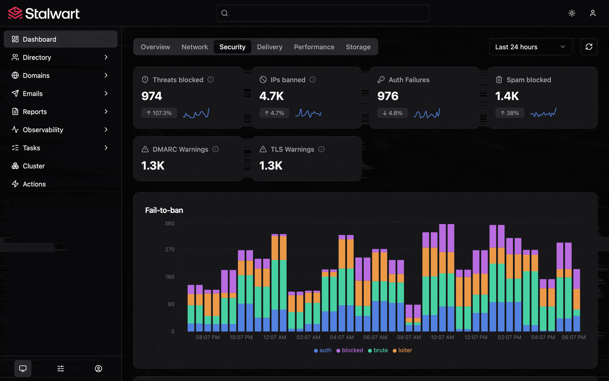

    

<h3 align="center">
  Secure, scalable mail & collaboration server with comprehensive protocol support 🛡️  (IMAP, JMAP, SMTP, CalDAV, CardDAV, WebDAV)
</h3>

 

  
  &nbsp;
  
  &nbsp;
  
  &nbsp;
  <a href="https://github.com/stalwartlabs/stalwart/releases"></a

  
  &nbsp;
  
  
  &nbsp;
  

## Features

**Stalwart** is an open-source mail & collaboration server with JMAP, IMAP4, POP3, SMTP, CalDAV, CardDAV and WebDAV support and a wide range of modern features. It is written in Rust and designed to be secure, fast, robust and scalable.

Key features:

- **Email** server with complete protocol support:
  - JMAP: 
    * [JMAP for Mail](https://datatracker.ietf.org/doc/html/rfc8621) server.
    * [JMAP for Sieve Scripts](https://www.rfc-editor.org/rfc/rfc9661.html).
    * [JMAP Object Metadata](https://datatracker.ietf.org/doc/html/draft-ietf-jmap-metadata-04) for e-mails, mailboxes, calendars, contacts, files and Sieve scripts.
    * [WebSocket](https://datatracker.ietf.org/doc/html/rfc8887), [Blob Management](https://www.rfc-editor.org/rfc/rfc9404.html) and [Quotas](https://www.rfc-editor.org/rfc/rfc9425.html) extensions.
  - IMAP:
    * [IMAP4rev2](https://datatracker.ietf.org/doc/html/rfc9051) and [IMAP4rev1](https://datatracker.ietf.org/doc/html/rfc3501) server.
    * [ManageSieve](https://datatracker.ietf.org/doc/html/rfc5804) server.
    * Numerous [extensions](https://stalw.art/docs/development/rfcs#imap4-and-extensions) supported.
  - POP3:
    - [POP3](https://datatracker.ietf.org/doc/html/rfc1939) server.
    - [STLS](https://datatracker.ietf.org/doc/html/rfc2595) and [SASL](https://datatracker.ietf.org/doc/html/rfc5034) support as well as other [extensions](https://datatracker.ietf.org/doc/html/rfc2449).
  - SMTP:
    * SMTP server with built-in [DMARC](https://datatracker.ietf.org/doc/html/rfc7489), [DKIMv2](https://datatracker.ietf.org/doc/draft-ietf-dkim-dkim2-spec/) (including post-quantum signatures), [DKIMv1](https://datatracker.ietf.org/doc/html/rfc6376), [SPF](https://datatracker.ietf.org/doc/html/rfc7208) and [ARC](https://datatracker.ietf.org/doc/html/rfc8617) support for message authentication.
    * Strong transport security through [DANE](https://datatracker.ietf.org/doc/html/rfc6698), [MTA-STS](https://datatracker.ietf.org/doc/html/rfc8461) and [SMTP TLS](https://datatracker.ietf.org/doc/html/rfc8460) reporting.
    * Automated DKIM key rotation and management.
    * Inbound throttling and filtering with granular configuration rules, sieve scripting, MTA hooks and milter integration.
    * Distributed virtual queues with delayed delivery, priority delivery, quotas, routing rules and throttling support.
    * Envelope rewriting and message modification.
- **Collaboration** server:
  - Calendaring and scheduling:
    - [CalDAV](https://datatracker.ietf.org/doc/html/rfc4791) and [CalDAV Scheduling](https://datatracker.ietf.org/doc/html/rfc6638) support.
    - [JMAP for Calendars](https://datatracker.ietf.org/doc/html/draft-ietf-jmap-calendars-32) support.
  - Contact management:
    - [CardDAV](https://datatracker.ietf.org/doc/html/rfc6352) support.
    - [JMAP for Contacts](https://datatracker.ietf.org/doc/html/rfc9610) support.
  - File storage:
    - [WebDAV](https://datatracker.ietf.org/doc/html/rfc4918) support.
    - [JMAP for File Storage](https://datatracker.ietf.org/doc/html/draft-ietf-jmap-filenode-17) support.
  - Sharing with fine-grained access controls:
    - [WebDAV ACL](https://datatracker.ietf.org/doc/html/rfc3744) support.
    - [JMAP Sharing](https://datatracker.ietf.org/doc/html/rfc9670) support.
- **Spam** and **Phishing** built-in filter:
  - Comprehensive set of filtering **rules** on par with popular solutions.
  - AI spam classifier with support for OpenAI-compatible, Anthropic, Google Gemini and Ollama models.
  - Statistical **spam classifier** with collaborative filtering, automatic training capabilities and address book integration.
  - DNS Blocklists (**DNSBLs**) checking of IP addresses, domains, and hashes.
  - Collaborative digest-based spam filtering with **Pyzor**.
  - **Phishing** protection against homographic URL attacks, sender spoofing and other techniques.
  - Trusted **reply** tracking to recognize and prioritize genuine e-mail replies.
  - Sender **reputation** monitoring by IP address, ASN, domain and email address.
  - **Greylisting** to temporarily defer unknown senders.
  - **Spam traps** to set up decoy email addresses that catch and analyze spam.
- **Flexible**:
  - Pluggable storage backends with **RocksDB**, **FoundationDB**, **PostgreSQL**, **mySQL**, **SQLite**, **S3-Compatible**, **Azure** and **Redis** support.
  - Full-text search available in 17 languages using the built-in search engine or via **Meilisearch**, **ElasticSearch**, **OpenSearch**, **PostgreSQL** or **mySQL** backends.
  - Text extraction and indexing of **PDF**, **Microsoft Office**, **OpenDocument**, **EPUB** and **RTF** documents.
  - Sieve scripting language with support for all [registered extensions](https://www.iana.org/assignments/sieve-extensions/sieve-extensions.xhtml).
  - Email aliases, mailing lists, subaddressing and catch-all addresses support.
  - Automated DNS management.
  - Automatic account configuration and discovery with [PACC](https://datatracker.ietf.org/doc/draft-ietf-mailmaint-pacc/), [autoconfig](https://datatracker.ietf.org/doc/draft-ietf-mailmaint-autoconfig/) and [autodiscover](https://learn.microsoft.com/en-us/exchange/architecture/client-access/autodiscover?view=exchserver-2019). 
  - Multi-tenancy support with domain and tenant isolation.
  - Disk quotas per user and tenant.
- **Secure and robust**:
  - Encryption at rest with **S/MIME** or **OpenPGP**.
  - Automatic TLS certificate provisioning with [ACME](https://datatracker.ietf.org/doc/html/rfc8555) using `TLS-ALPN-01`, `DNS-01`, `DNS-PERSIST-01` or `HTTP-01` challenges.
  - Automated blocking of IP addresses that attack, abuse or scan the server for exploits.
  - SSRF protection for outbound requests.
  - Rate limiting.
  - Security audited (read the [report](https://stalw.art/blog/security-audit)).
  - Memory safe (thanks to Rust).
- **Scalable and fault-tolerant**:
  - Designed to handle growth seamlessly, from small setups to large-scale deployments of thousands of nodes.
  - Built with **fault tolerance** and **high availability** in mind, recovers from hardware or software failures with minimal operational impact. 
  - Peer-to-peer cluster coordination or with **Kafka**, **Redpanda**, **NATS** or **Redis**.
  - **Kubernetes**, **Apache Mesos** and **Docker Swarm** support for automated scaling and container orchestration.
  - Read replicas, sharded blob storage and in-memory data stores for high performance and low latency.
  - Tiered caching with snapshots that can be swapped to disk, Redis or the blob store.
- **Authentication and Authorization**:
  - **OpenID Connect** authentication.
  - OAuth 2.0 authorization with [authorization code](https://www.rfc-editor.org/rfc/rfc8628) and [device authorization](https://www.rfc-editor.org/rfc/rfc8628) flows.
  - OAuth scopes, connected applications management and [Client ID Metadata Documents](https://datatracker.ietf.org/doc/draft-ietf-oauth-client-id-metadata-document/).
  - **LDAP**, **OIDC**, **SQL** or built-in authentication backend support.
  - System for Cross-domain Identity Management ([SCIM](https://www.rfc-editor.org/info/rfc7643/)) v2 for automated provisioning.
  - Two-factor authentication with Time-based One-Time Passwords (`2FA-TOTP`) 
  - Application passwords (App Passwords).
  - Roles and permissions.
  - Access Control Lists (ACLs).
- **Observability**:
  - Logging and tracing with **OpenTelemetry**, journald, log files and console support.
  - Metrics with **OpenTelemetry** and **Prometheus** integration.
  - Webhooks for event-driven automation.
  - Alerts with email and webhook notifications.
  - Live tracing and metrics.
- **Web-based administration**:
  - Dashboard with real-time statistics and monitoring.
  - Account, domain, group and mailing list management.
  - SMTP queue management for messages and outbound DMARC and TLS reports.
  - Report visualization interface for received DMARC, TLS-RPT and Failure (ARF) reports.
  - Configuration of every aspect of the mail server.
  - Log viewer with search and filtering capabilities.
  - Self-service portal for password reset and encryption-at-rest key management.

## Screenshots

## Presentation

Whether you are evaluating options, presenting Stalwart to your team or your boss, or just curious about how it works under the hood, the [slides](https://stalw.art/slides) walk you through its key features, architecture and benefits.

## Get Started

Install Stalwart on your server by following the instructions for your platform:

- [Linux / MacOS / FreeBSD](https://stalw.art/docs/install/platform/linux)
- [Windows](https://stalw.art/docs/install/platform/windows)
- [Docker](https://stalw.art/docs/install/platform/docker)

All documentation is available at [stalw.art/docs](https://stalw.art/docs/install/get-started).

## Where do I get support?

If you run into a problem, find a bug or have a question, head to the [Stalwart Support Portal](https://support.stalw.art). It is free for everyone, and our team answers.

Organizations that need more can purchase an [Enterprise license](https://stalw.art/enterprise) for priority support from Stalwart Labs LLC, with response-time commitments and a private Priority Support area on the portal.

## Why isn't everything AGPL?

About 85% of Stalwart's features are free and open source under the AGPL-3.0. The rest make up the [Enterprise edition](https://stalw.art/enterprise/), and are mostly features that matter to large organizations and hosting providers running Stalwart at scale, such as multi-tenancy, SCIM provisioning, sharded storage and live telemetry. The full breakdown is on the [comparison page](https://stalw.art/compare/).

Stalwart is built by a full-time professional team, not as a side project, and open source sponsorship covers only a small fraction of what that costs. Enterprise subscriptions pay for the work that every Stalwart user benefits from:

- The engineers who maintain and extend the Community edition, with a new release every week.
- Security fixes within 24 hours of a report, and an independent security audit every time a large part of Stalwart is rewritten.
- Free community support at [support.stalw.art](https://support.stalw.art).
- Stress tests and benchmarks on dozens of cloud servers at a time across many regions.
- Work on email standards at the IETF, where we are the authors of multiple Internet-Drafts in progress.

The Community edition is complete and open source, and it will stay that way:

- Stalwart remains licensed under the AGPL-3.0.
- No existing open source feature will ever be moved to the Enterprise edition.
- Most new features go to the Community edition.

If you find Stalwart useful, there are two ways to help keep it free. If your organization needs Enterprise features, [subscribe to the Enterprise edition](https://stalw.art/pricing/). Otherwise, you can [become a sponsor on OpenCollective](https://opencollective.com/stalwart): sponsors who contribute $5 per month or more automatically receive an Enterprise license, and those who contribute $30 per month or more also get access to [Premium Support](https://stalw.art/support) from Stalwart Labs. Thank you!

## How can I contribute?

Contributions are welcome, with a few rules that keep the project maintainable:

- Because of the high volume of low-quality, AI-generated submissions, only vouched contributors can open pull requests. To be added to the list, post at [support.stalw.art](https://support.stalw.art) describing the change you would like to submit, with a link to it.
- For now, only bug fixes and translations are accepted. New features are not, unless they are just a few lines of code.

The full guidelines are in [CONTRIBUTING.md](CONTRIBUTING.md). You can also help without writing code: report bugs, answer questions on the support portal, or tell others about Stalwart.

## Funding

Part of the development of this project was funded through:

- [NGI0 Entrust Fund](https://nlnet.nl/entrust), a fund established by [NLnet](https://nlnet.nl/) with financial support from the European Commission's [Next Generation Internet](https://ngi.eu/) programme, under the aegis of DG Communications Networks, Content and Technology under grant agreement No 101069594.
- [NGI Zero Core](https://nlnet.nl/NGI0/), a fund established by [NLnet](https://nlnet.nl/) with financial support from the European Commission's programme, under the aegis of DG Communications Networks, Content and Technology under grant agreement No 101092990.

## License

This project is dual-licensed under the **GNU Affero General Public License v3.0** (AGPL-3.0; as published by the Free Software Foundation) and the **Stalwart Enterprise License v2 (SELv2)**:

- The [GNU Affero General Public License v3.0](./LICENSES/AGPL-3.0-only.txt) is a free software license that ensures your freedom to use, modify, and distribute the software, with the condition that any modified versions of the software must also be distributed under the same license. 
- The [Stalwart Enterprise License v2 (SELv2)](./LICENSES/LicenseRef-SEL.txt) is a proprietary license designed for commercial use. It offers additional features and greater flexibility for businesses that do not wish to comply with the AGPL-3.0 license requirements. 

Each file in this project contains a license notice at the top, indicating the applicable license(s). The license notice follows the [REUSE guidelines](https://reuse.software/) to ensure clarity and consistency. The full text of each license is available in the [LICENSES](./LICENSES/) directory.

## Copyright

Copyright (C) 2020, Stalwart Labs LLC
